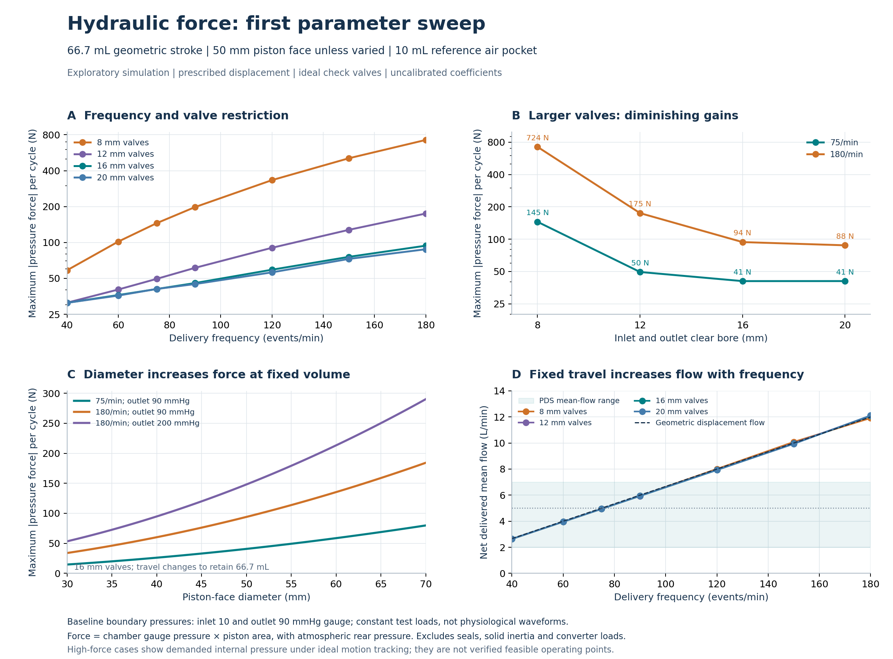

# Design 1: Piston Pump — living model

This document is the maintained explanation of the model. The executable
calculation entry point is [Pump_Model_Live.m](matlab/Pump_Model_Live.m).
The first numerical results are preserved in the [reference archive](archive/).
Update this document and [DECISIONS.md](DECISIONS.md) when a modelling decision
changes; retain previous numerical snapshots so changes can be traced.

## 1. Purpose and current status

Estimate geometric displacement, delivered liquid volume, pressure history
and peak hydraulic force for a plunger piston with no wetted rod. The actuator
and rotary-to-linear converter are outside this stage. The current dynamic
model represents one ventricular pump chamber and imposed pressure loads.
It does not simulate both circulation loops or an actual Windkessel circuit.

The archived Python sweep contains 118 attempted dynamic cases: 117 periodic
solutions and one stopped by a low-pressure guard. The MATLAB translation is
prepared, with runtime comparison pending. Neither implementation is calibrated
or independently validated against a physical pump.

## 2. Inputs, assumptions and units

| Quantity | Current value or range | Status / provenance |
| --- | --- | --- |
| Nominal mean circuit flow | 5 L/min | User-prescribed |
| Nominal delivery frequency | 75 beats/min | User-prescribed; overrides the earlier PDS nominal rate |
| Exploratory frequency range | 40–180 beats/min | PDS range used in the previous sweep |
| Mean-flow range | 2–7 L/min | PDS; compatible combinations remain to be chosen |
| Geometric swept volume | 66.6667 mL | Ideal 5 L/min ÷ 75/min reference; not actual delivered volume |
| Face diameter / travel | 50 mm / 33.95 mm | Illustrative; both remain design variables |
| Wetted rod area | None | User's flat-face plunger concept |
| Inlet / outlet boundaries | 10 / 90 mmHg gauge, constant | PDS reference levels; constant-boundary treatment is an assumption |
| Outlet sensitivities | 120 and 200 mmHg gauge, constant | Additional loads, not reproduced physiological waveforms |
| Pressure behind piston | Atmospheric | Assumption |
| Gas reference volume | 1, 10 or 20 mL; baseline 10 mL | Deliberately retained sealed air; values assumed |
| Gas reference pressure | 10 mmHg gauge | Assumption; absolute pressure used in gas law |
| Atmospheric pressure | 760 mmHg | Assumption |
| Polytropic exponent | 1.2; sensitivities 1 and 1.4 | Assumption; gas heat transfer not solved |
| Inlet and outlet valve bores | Both 8, 12, 16 or 20 mm | Assumed effective clear bores; varied together |
| Discharge coefficient | 0.7; sensitivities 0.6 and 0.8 | Uncalibrated |
| Fluid density | 1000 kg/m³ | Water-like assumption; not BMF characterisation |
| Each hydraulic leg | 20 mm bore, 0.2 m effective inertial length, K = 1 | Assumed lumped line model |
| Advance fraction | 0.4; sensitivities 0.3 and 0.5 | Smooth prescribed motion; no mechanism selected |
| Minimum chamber volume | 40 mL | Assumed residual volume; includes gas plus residual liquid |
| Leakage | Zero | Initial simplification |

The current scripts contain no viscosity-dependent BMF loss calibration. The
coefficient K is a lumped quadratic loss assumption, not a derived pipe-friction
factor. A selected cylinder's total length must also accommodate the piston,
residual volume, ports and end clearance; travel is not automatically total
cylinder length minus plunger thickness.

## 3. Displacement, flow and frequency

Define A as piston-face area, D as face diameter and S as piston travel.

- A = π D² / 4.
- Geometric swept volume Vₛ = A S.
- With D and S in mm, Vₛ [mL] = π D² S / 4000.
- With f in beats/min and Vnet in mL/beat, Qmean [L/min] = f Vnet / 1000.
- Therefore Vnet,required [mL/beat] = 1000 Qtarget / f.

The last two relations are cycle-volume accounting, not empirical pump laws.
For ideal fully filled liquid displacement with one delivery per beat and no
diversion, Vnet = Vₛ. With retained gas and valve transients, Vnet is obtained
by integrating the outlet flow. A delivery ratio Vnet/Vₛ is an output of the
hydraulic model; it is not an independently adjustable controller input.

For our 66.6667 mL ideal reference:

| Frequency | Ideal full-stroke flow | Net volume needed for 5 L/min | Ideal diverted fraction to retain 5 L/min |
| --- | --- | --- | --- |
| 40/min | 2.667 L/min | 125.00 mL/beat | Not attainable by diversion of this stroke |
| 75/min | 5.000 L/min | 66.67 mL/beat | 0% |
| 120/min | 8.000 L/min | 41.67 mL/beat | 37.5% |
| 180/min | 12.000 L/min | 27.78 mL/beat | 58.33% |

At 180/min, ideal diversion would return 38.89 mL per beat, or 7 L/min,
while 5 L/min enters the test circuit. These are volume budgets, not an
implemented valve design. The actual baseline simulation at 75/min delivers
about 4.945 L/min because its net delivery differs from the ideal swept volume.

**A fixed stroke supports a prescribed compatible flow/bpm pair. It does not
provide independent control of arbitrary flow and bpm pairs by itself.**

For two ventricular chambers in series, each chamber must support the circuit
flow; do not sum left and right flow to claim doubled cardiac output. In a
single time-multiplexed chamber, distinguish mechanical delivery frequency
from deliveries per minute to each circuit before applying these equations.

## 4. How independent control could be obtained

| Alternative | Fixed mechanical travel retained? | What changes | Consequences to assess |
| --- | --- | --- | --- |
| Controlled bypass or diversion to a reservoir | Yes | Fraction of expelled volume reaching the circuit | Additional valves/path and flow measurement; timing and pressure load must be modelled |
| Controlled spill through an actively operated inlet during early advance | Yes | Effective delivery portion of each stroke | Requires active valve timing; passive checks alone cannot command this behaviour |
| Variable effective piston travel | No | Geometric displacement per beat | Direct volume control, but conflicts with the current fixed-travel assumption |
| Change bore or exchange cylinder | Fixed within each selected configuration | Displacement per beat | Discrete hardware choices, not continuous run-time control |
| Skip delivery events | Travel may remain fixed | Number of delivered pulses | Changes actual delivery frequency; does not preserve a pulse every requested beat |

Changing only the speed profile within each beat changes instantaneous flow,
pressure and filling time. With ideal full filling and the same stroke, it does
not change the integrated delivered volume. Throttling a fully filled,
incompressible, leak-free displacement pump primarily changes pressure demand;
it does not by itself create independent mean-flow control. Incomplete filling
can change actual delivery, but deliberately relying on starvation introduces
load-dependent behaviour rather than a prescribed volume command.

A sealed air pocket provides compliance. Its volume and pressure change during
the cycle and must return to the same state in periodic operation. It can alter
the net delivery by delaying valve opening and expanding during return, but it
cannot accumulate excess liquid indefinitely or serve as an independently
commanded flow setting merely because its initial amount is known. Similarly,
a Windkessel stores and releases volume within a cycle; at periodic steady
state its net stored volume per cycle is zero. A separate control degree of
freedom is still needed for independent flow/bpm selection.

Keep both strategies open: (A) fixed stroke with flow allowed to rise with bpm,
and (B) prescribed circuit flow with an added means of varying net delivery.
No bypass or spill strategy has been selected or added to the hydraulic solver.

## 5. Current hydraulic equations

Use SI units for this section: p in Pa, volume in m³, flow in m³/s, time in s,
area in m². The scripts convert to mmHg/mL/s internally using
1 mmHg = 133.322387415 Pa and 1 mL = 10⁻⁶ m³.

Let u(t) = A x(t) be piston displacement volume, positive on advance. Let pc
be chamber pressure, pi upstream pressure, po downstream pressure and pb rear
pressure. Qi and Qo are positive forward inlet/outlet flows. With a rigid
chamber, incompressible liquid and a sealed polytropic gas pocket:

- Gas law: Vg = Vg0 (pg0,abs / pc,abs)^(1/n).
- Gas compliance: Cg = Vg / (n pc,abs), in m³/Pa.
- Chamber balance: Cg dpc/dt = Qi − Qo + du/dt.
- Open inlet: Ii dQi/dt = pi − pc − Bi Qi |Qi|.
- Open outlet: Io dQo/dt = pc − po − Bo Qo |Qo|.
- Each leg: I = ρ ℓ / At, in Pa·s²/m³.
- Each leg: B = (ρ/2) [1/(Cd Av)² + K/At²], in Pa·s²/m⁶.
- Valve area Av = π dv²/4; line area At = π dt²/4.
- Liquid inventory: Vl = Vmin + Vₛ − u − Vg.

Ideal check valves open when their forward pressure difference becomes positive
and close when their forward flow reaches zero. Fluid inertia can temporarily
maintain forward flow after the pressure gradient reverses. The ideal model can
also permit brief simultaneous forward inlet/outlet flow and net-delivery
ratios slightly above one. This behaviour requires physical valve validation;
the ratio should not be interpreted as a calibrated conventional efficiency.

Let h(z) = 10z³ − 15z⁴ + 6z⁵, T = 60/f seconds and γ be the advance fraction.
During advance, u = Vₛ h[t/(γT)]. During return,
u = Vₛ {1 − h[(t−γT)/((1−γ)T)]}. Velocity and acceleration are zero at the
phase boundaries. Equal travel is used on advance and return; their durations
can differ. Unequal net travel over a repeated closed cycle would cause drift.

The gas-free reference is a separate imposed-full-fill calculation with flow
equal to piston displacement rate. Its pressure is calculated from the same
loss and inertance terms and screened for impossible low-pressure conditions.
It is not a zero-gas ODE run, because Cg = 0 makes that formulation singular.

## 6. Force and what the reported maximum means

Hydraulic pressure load: Fp(t) = A [pc(t) − pb].
Reported maximum: max |Fp(t)| over the final periodic cycle.

The sign denotes the required balancing force along the piston advance axis.
With an atmospheric rear, gauge chamber pressure can be used directly. This
is not A(po−pi): inlet pressure is not the pressure acting on the rear face.
Chamber pressure includes valve losses and fluid acceleration, so it can be
much greater than the imposed outlet pressure.

Seal friction, moving-solid inertia, converter forces, start/stop transients
and blocked-path cases are excluded. There is no universal maximum force until
the admissible pressure boundaries, motion profiles and flow paths are defined.

| Valve bores | Peak hydraulic force at 75/min | At 180/min |
| --- | --- | --- |
| 8 mm | 145 N | 724 N |
| 12 mm | 50 N | 175 N |
| 16 mm | 41 N | 94 N |
| 20 mm | 41 N | 88 N |

These rows use the baseline inputs in section 2. The largest sensitivity case
was approximately 1275 N (180/min, 8 mm valves, γ = 0.3), implying about
4870 mmHg gauge chamber pressure. This is an extreme demanded load under
assumed perfect motion tracking, not an endorsed operating condition.

## 7. Verification and model limits

The executed Python reference used event-driven SciPy Radau integration,
relative tolerance 2×10⁻⁷ and maximum step T/120. Three cases were refined with
relative tolerance 2×10⁻⁹, maximum step T/360 and denser peak sampling. Checked
force changes were below 0.001%. Across completed cases the largest volume
balance residual was 3.14×10⁻⁶ mL and periodic inlet/outlet volume mismatch was
4.77×10⁻⁷ mL. Full records are in the archive.

The low-pressure guard is 50 mmHg absolute (6.67 kPa), an exploratory validity
floor, not a measured cavitation threshold. Passing this check does not rule
out local valve cavitation. A separate liquid-inventory guard is 0.1 mL.
One case stopped: 180/min, 8 mm valves, 1 mL reference air. No periodic force
result is fabricated for it.

The MATLAB port uses ode15s and explicit valve events. `verify_reference.m`
checks three representative cases against the executed CSV data to 0.1% in
force and flow, plus conservation, endpoint kinematics and the expected guard.
This check has not yet been executed in MATLAB. Source parsing alone cannot
establish numerical equivalence.

Constant reservoirs exclude reservoir depletion and recirculation shortages.
Actual Windkessel pressure histories, finite valve motion, compressibility of
the liquid, wall elasticity, gas heat transfer/dissolution and BMF rheology
remain outside this implementation. Numerical verification is distinct from
calibration and from independent validation; none establishes clinical
prediction accuracy.

## 8. Evidence and archived derivations

- [Hydraulic sweep report](archive/pump_hydraulic_sweep/Hydraulic_force_sweep.pdf)
  and [LaTeX source](archive/pump_hydraulic_sweep/Hydraulic_force_sweep.tex).
- [Earlier coupled-model derivation](archive/pump_coupled_model/Pump_coupled_model.pdf)
  and [LaTeX source](archive/pump_coupled_model/Pump_coupled_model.tex).
- [Initial displacement/geometry plots](archive/pump_tradeoffs/Pump_parameter_tradeoffs.pdf).
- Broomé et al. (2013), cardiovascular nonlinear valve-loss/inertance model:
  https://doi.org/10.1186/1475-925X-12-69. Model-structure precedent; its
  parameters and validation are not inherited by this pump.
- Iannetti et al. (2015), reciprocating-pump cavitation/compressibility study:
  https://doi.org/10.17265/2332-8215/2015.01.005. Explains regimes excluded here;
  it does not validate the present lumped model.
- MathWorks, [Live Code File Formats](https://www.mathworks.com/help/matlab/matlab_prog/file-format-for-live-scripts.html):
  official software documentation for the plain-text Live Script format,
  supported since R2025a. This source supports the file format, not pump physics.

## 9. Next staged decisions

1. Run the MATLAB comparison and record the release, errors and pass/fail result.
2. Agree compatible flow/frequency combinations and whether net-delivery control
   must retain fixed mechanical travel.
3. Compare the additional flow-control paths before selecting one.
4. Replace assumed valve/line data and boundary pressures with selected-component
   data or measurements; then repeat the force sweep.
5. Choose geometry using feasible operating cases before sizing the converter.
