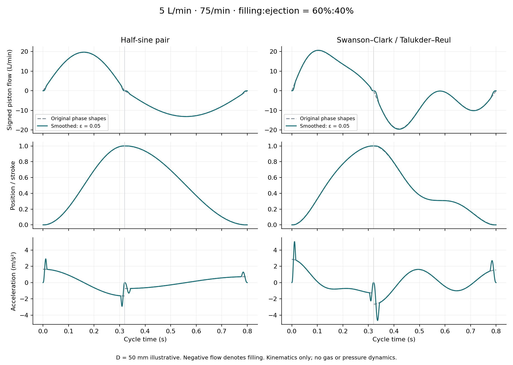

# Volume-preserving waveform joining

22 November 2026. Analytical kinematics for one dedicated ventricular chamber.

## Purpose and assumptions

Make candidate flow profiles usable for the next pressure derivation by removing
acceleration jumps at stroke reversals. Retain independent choices of shape,
phase timing and phase volume. This step assumes full liquid filling, no leakage,
no storage, no dwell and feasible ideal valve states. It does not establish those
valve states or include the retained gas pocket. It is not the alternating
right/left schedule of the single shared-chamber concept.

The baseline is 5 L/min and 75 deliveries/min per circuit. The provisional 60:40
ratio means **filling:ejection**. The 50 mm piston diameter is illustrative.

$$
V_s=\frac{1000\bar Q}{h}=66.6667\ \mathrm{mL},\quad
T=\frac{60}{h}=0.8\ \mathrm{s},\quad
t_e=\gamma T=0.32\ \mathrm{s},\quad t_f=(1-\gamma)T=0.48\ \mathrm{s}.
$$

Here mean flow is in L/min, rate h in deliveries/min and gamma is the ejection
fraction. If a manufactured pump has fixed travel, these are feasibility
relations: changing rate at constant mean flow changes the required swept volume.
The spreadsheet does not confer variable stroke on fixed hardware.

## Published shapes and the joining problem

Use the half-sine pair or the Swanson–Clark ejection / Talukder–Reul filling
coefficients documented in [WAVEFORM_CANDIDATES.md](WAVEFORM_CANDIDATES.md).
The coefficients were inspected in the supplied Franzetti et al. 2019 PDF,
p. 5, Eqs 13–15, DOI [10.1115/1.4044488](https://doi.org/10.1115/1.4044488).
The original 1977/1978 papers were not independently read. The following window
is **our engineering extension**, not a published physiological prescription or
a reproduction of Franzetti's optimisation routine.

For phase time u between zero and one, raw flow shapes vanish at their endpoints.
Their slopes generally do not. Independently scaling ejection and filling to
equal volume therefore preserves position and velocity but can leave jumps in
acceleration. The raw half-sine pair would join with matching acceleration at
equal durations; the present unequal durations do not satisfy that condition.

## Adjustable endpoint window

Let epsilon be the fraction of each phase used for each endpoint transition,
with 0 < epsilon <= 0.5. Define

$$
H(z)=10z^3-15z^4+6z^5,
\qquad H'(z)=30z^2(1-z)^2,
$$

$$
w_\epsilon(u)=
\begin{cases}
H(u/\epsilon),&0\le u<\epsilon,\\
1,&\epsilon\le u\le1-\epsilon,\\
H((1-u)/\epsilon),&1-\epsilon<u\le1.
\end{cases}
$$

At epsilon = 0 use w = 1 and its derivative zero: this intentionally restores
the unsmoothed reference. Zero smoothing does not pass the acceleration-join
criterion at the baseline timing.

For either phase j, retain its prescribed volume through renormalisation:

$$
G_j=\int_0^1 g_j(u)w_\epsilon(u)\,\mathrm du,\qquad
\phi_j(u)=\frac{g_j(u)w_\epsilon(u)}{G_j},\qquad
Q_j(t)=\frac{V_s}{t_j}\phi_j(u).
$$

Thus the time integral of each positive phase flow is exactly V_s in the
continuous model. In the spreadsheet G is evaluated by composite trapezoidal
quadrature, with 400 intervals per phase, and the same quadrature is used for
position. That gives discrete volume conservation, with quadrature accuracy
checked separately against high-order Gauss integration in Python.

The signed piston flow and its derivative are

$$
Q_p=\sigma_j\frac{V_s}{t_j}\phi_j,
\qquad
\dot Q_p=\sigma_j\frac{V_s}{t_j^2}
\frac{g'_jw_\epsilon+g_jw'_\epsilon}{G_j},
\qquad \sigma_e=1,\quad\sigma_f=-1.
$$

Negative piston flow means filling. It does not mean reverse aortic outlet flow.
With area A_p and stroke S, using SI units throughout the following expressions:

$$
A_p=\frac{\pi D_p^2}{4},\quad S=\frac{V_s}{A_p},\quad
\dot x=\frac{Q_p}{A_p},\quad \ddot x=\frac{\dot Q_p}{A_p},
$$

$$
\frac{x}{S}=
\begin{cases}
\displaystyle\int_0^u\phi_e(v)\,\mathrm dv,&\text{ejection},\\[5pt]
\displaystyle1-\int_0^u\phi_f(v)\,\mathrm dv,&\text{filling}.
\end{cases}
$$

For positive epsilon, flow, flow slope and flow second derivative vanish at
the phase endpoints. Position, velocity and acceleration consequently join
continuously, including the end-to-start cycle boundary. This is a kinematic
property, not a guarantee of continuous hydraulic force when valves or pressure
connections switch. The transition into the middle window is also smooth through
the second derivative of flow.

## What the first comparison shows

The trial epsilon = 0.05 corresponds to **16 ms at each ejection endpoint** and
**24 ms at each filling endpoint**. It is a sensitivity case, not an optimised
or physiological choice. All rows use the same volume, rate and timing.

| Pair | Smoothing | Peak ejection (L/min) | Peak filling (L/min) | Maximum absolute piston acceleration (m/s²), D = 50 mm |
|---|---|---:|---:|---:|
| Half-sine | None | 19.635 | 13.090 | 1.636 |
| Half-sine | 5% each endpoint | 19.704 | 13.136 | 2.909 |
| Published harmonics | None | 20.567 | 19.401 | 2.845 |
| Published harmonics | 5% each endpoint | 20.658 | 19.598 | 5.026 |

Smoothing removes jumps but increases the maximum finite acceleration by about
77–78% in this trial. Suppressing flow near the endpoints and catching up to the
original shape requires a faster change in flow within the transition. The
renormalisation also raises the flow outside that transition slightly. Neither
effect demonstrates an improvement in maximum hydraulic force.



The previously documented quintic-position reference remains an alternative
with smooth reversals. It can sacrifice the published pulse shape to obtain a
different acceleration distribution. Optimising a blend against acceleration,
jerk, hydraulic force and waveform error remains open; no width is selected.

## Numerical checks and next interface

`build_smooth_waveforms.py` checks phase volumes, positive forward phase flows,
return position, both acceleration joins, analytic derivatives against centred
finite differences and integral convergence at 200/400/800 intervals. It records
width sensitivity for epsilon = 0, 0.02, 0.05, 0.10 and 0.15. These are numerical
checks of a prescribed command, not calibration or physical validation.

The workbook adds formula-driven shape selection, smoothing width, flow,
velocity, acceleration and displacement. Mean flow, rate, diameter and ejection
fraction link to the existing Pressure start inputs. The old local-pressure
calculation remains a separate illustrative instant and is not automatically
the force required by this waveform.

Next, insert the selected Q and dQ/dt into the full-liquid open-path pressure law,
check the assumed valve states throughout the cycle, and only then interpret a
maximum hydraulic force. With the retained gas pocket, piston displacement flow
and outlet flow will differ, so these prescribed full-liquid flow shapes cannot
simply be imposed on both simultaneously.

Reproduce from the design directory:

```sh
python research/build_smooth_waveforms.py
python research/build_smooth_waveforms.py --epsilon 0.10 --output results/epsilon_010
```
