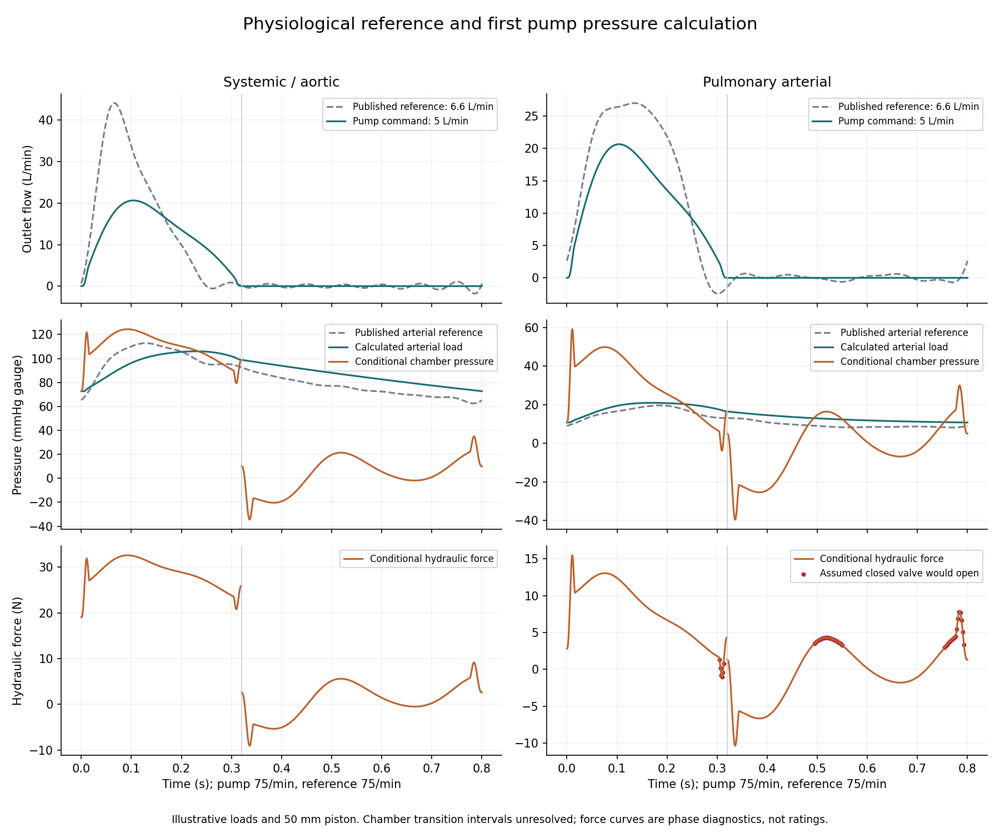

# Pressure histories, force and the heart reference

22 November 2026. First periodic arterial-load calculation, with conditional
open-valve pump phases. No gas or valve-event solution is claimed.

## What we are comparing

The aim is to generate appropriate cardiovascular pressure and flow conditions
at declared measurement locations. An arterial pulse, ventricular pressure and
pressure inside the EVAR phantom are different outputs.

| Rig quantity | Appropriate physiological comparator | Current comparison |
|---|---|---|
| Left pump chamber pressure | Left ventricular pressure | Phase diagnostics only; no quantitative human LV trace adopted |
| Systemic load inlet pressure | Ascending-aortic pressure | Published functional arterial reference reconstructed below |
| Right pump chamber pressure | Right ventricular pressure | Phase diagnostics only; no quantitative human RV trace adopted |
| Pulmonary load inlet pressure | Main pulmonary arterial pressure | Published functional arterial reference reconstructed below |
| Phantom inlet pressure and flow | Corresponding abdominal-aortic plane | Not inferred from the proximal pump signal; intervening circuit and branches matter |

Qureshi et al. [1], author manuscript Appendix A Table A1 and Dataset 1, provide
ten-harmonic human arterial reference signals reproduced from Milnor (1989).
They describe 75 beats/min and 6.6 L/min. These are a published functional
reference, not raw clinical recordings obtained for this project. The original
Milnor acquisition and subject details were not independently inspected.

We retain the tabulated coefficients and reconstruct without clipping reverse
flow, changing pressure offsets, fitting parameters, or rescaling to 5 L/min:

$$
s(t)=\bar s+\sum_{k=1}^{10}S_k\cos\left(2\pi k\frac{t}{T}+\phi_k\right).
$$

The numerical coefficients are in `heart_reference_harmonics.csv`; amplitudes
are mL/s for flow and mmHg for pressure, and phases are radians. Both reference
signals share their original time origin. Harmonic truncation and rounded
coefficients limit the interpretation of small ripples and reverse-flow details.

Nichols et al. [2] supply independent primary human pressure–flow measurements
and show why arterial load belongs in this comparison. Their catheterisation
cohort included five subjects without objective cardiovascular disease, rather
than a large healthy-population reference sample. Manolas et al. [3] provide
primary simultaneous LV/aortic timing measurements; only the abstract was
accessible here. Its numerical timing values are not adopted as our defaults.

Packy et al. [4] demonstrate a 5 L/min, 120/80 mmHg mock-loop reference condition
and assess arterial waveform morphology. That is an engineering test precedent,
not a universal patient waveform or independent validation of our pump.

## Prescribed inputs and provisional loads

We retain 5 L/min, 75 deliveries/min, 66.667 mL per phase, 0.32 s ejection,
0.48 s filling, and an illustrative 50 mm plunger. The baseline uses the published
harmonic pair with the trial 5% endpoint window. Both sides deliberately use the
same ejection command in this first comparison; the Swanson–Clark aortic shape
is not asserted to be a physiological pulmonary flow prescription.

The downstream Windkessel is represented only as a load interface. Its hardware
is not being designed here. For each side:

$$
p_a=p_w+R_1Q_o,\qquad
C_w\frac{\mathrm dp_w}{\mathrm dt}=Q_o-\frac{p_w-p_r}{R_2}.
$$

Here p_a is the arterial/load-inlet pressure, p_w the compliance-node pressure,
p_r the terminal return pressure, and Q_o the pump outlet flow. Using mmHg,
mL and seconds, resistance has units mmHg s/mL and compliance mL/mmHg.
The input reservoir pressure p_i is distinct from p_r and from rear-face pressure.

| Input | Systemic trial | Pulmonary trial | Provenance |
|---|---:|---:|---|
| Inlet reservoir pressure (mmHg gauge) | 10 | 5 | Illustrative constant boundary |
| Terminal return pressure (mmHg gauge) | 5 | 10 | Illustrative constant boundary |
| R1 (mmHg s/mL) | 0.040 | 0.015 | Reference-informed illustrative values; not measured rig properties |
| R2 (mmHg s/mL) | 0.980 | 0.045 | Chosen for mean 90 / 15 mmHg at 5 L/min |
| Cw (mL/mmHg) | 1.5 | 5.0 | Free engineering trial values; not fitted |

The systemic R1 is close to the 53 dyn s/cm^5 characteristic impedance in the
small reference group of Nichols [2], equivalent to 0.03975 mmHg s/mL. The
pulmonary R1 uses the approximate 0.015 mmHg s/mL value in Qureshi [1]. Neither
transfer identifies a patient or calibrates the eventual rig.

At periodic steady state, integrating the compliance equation gives

$$
\bar p_a=p_r+(R_1+R_2)\bar Q_o.
$$

**The mean-pressure result is therefore imposed by our chosen resistance. It is
not independent physiological corroboration.** Pulse amplitude and timing are
calculated responses of the assumed load and command. Resistance stays fixed
when changing flow in a sensitivity run; it is not silently retuned.

## Solve the periodic load without an arbitrary start-up pressure

Set y = p_w − p_r and tau = R2 Cw. On each sampling interval, approximate Q_o
linearly between q_n and q_(n+1). With time step delta t:

$$
a_n=e^{-\Delta t_n/\tau},\qquad
b_n=R_2\left[q_n(1-a_n)+(q_{n+1}-q_n)
\left(1-\frac{\tau}{\Delta t_n}(1-a_n)\right)\right],
$$

$$
y_{n+1}=a_n y_n+b_n.
$$

Propagating once from zero gives B, while the homogeneous cycle multiplier is
A = exp(−T/tau). Then y(0) = B/(1−A) enforces y(T) = y(0). Duplicate phase-join
samples have zero time step and use a = 1, b = 0. This method is exact for the
piecewise-linear sampled flow; refining the samples checks approximation error.

During the no-outlet-flow interval:

$$
p_a(t)-p_r=[p_a(t_e)-p_r]e^{-(t-t_e)/\tau}.
$$

This gives arterial pressure decay while the pump fills. A lumped three-element
load does not independently represent distributed wave travel, reflection sites
or moving valve-leaflet closure. It cannot be expected to reproduce every notch
or secondary feature of a measured arterial trace.

## Chamber pressure and hydraulic force

Use the phase laws derived in `DERIVATION_01_FULL_LIQUID.md`:

$$
p_c=p_a+R_oQ_o+B_oQ_o^2+I_o\dot Q_o\quad\text{(ejection)},
$$

$$
p_c=p_i-R_iQ_i-B_iQ_i^2-I_i\dot Q_i\quad\text{(filling)},
$$

$$
F_h=A_p(p_c-p_b),\qquad A_p=\frac{\pi D_p^2}{4}.
$$

For SI flow and pressure, the initial path models are

$$
B=\frac{\rho}{2}\left[\frac{1}{(C_dA_v)^2}+\frac{K}{A_t^2}\right],
\qquad I=\frac{\rho L}{A_t}.
$$

The trial uses water-like density 1000 kg/m³, inlet/outlet valve bores 16 mm,
Cd = 0.7, tube bores 20 mm, lengths 0.2 m, and local K = 1. Additional linear
resistance remains excluded, not proven negligible. Both paths are uncalibrated;
using the same path on each side is an engineering comparison assumption.
Force converts mmHg to Pa using 133.322 Pa/mmHg. Solid inertia, seals and the
converter are excluded. Fluid inertia is already included in chamber pressure.

## Check whether the imposed phases are physically consistent

For ideal passive check valves with zero cracking pressure, an assumed-closed
inlet requires p_i <= p_c. An assumed-closed outlet requires p_c <= p_a. We check
these separately in ejection and filling. An already-open branch can maintain
positive flow while its pressure gradient opposes motion during deceleration;
that alone is not a valve-state failure.

There is a further limitation at both stroke reversals. With our smooth command,
flow and flow acceleration vanish, so the ejection endpoint gives p_c = p_a,
whereas the filling endpoint gives p_c = p_i. Unless those pressures coincide,
the phase formulas have a jump. Zero mechanical acceleration does not resolve
pressure-building or relaxation intervals. A finite chamber compliance/gas
model and valve-event dynamics must resolve the transition before a full-cycle
force maximum or ventricular waveform match can be claimed.

## First numerical comparison

All pressures in the table are mmHg gauge. Reference values are calculated from
the published coefficients, not population normal ranges. The different mean
flows and different load conditions prevent interpreting discrepancies as
validation errors.

| Quantity | Aortic reference | Systemic pump trial | Pulmonary reference | Pulmonary pump trial |
|---|---:|---:|---:|---:|
| Mean flow (L/min) | 6.6 | 5.0 | 6.6 | 5.0 |
| Rate (/min) | 75 | 75 | 75 | 75 |
| Mean arterial pressure | 85.0 | 90.0 | 12.0 | 15.0 |
| Minimum arterial pressure | 62.5 | 72.6 | 8.2 | 10.8 |
| Maximum arterial pressure | 112.8 | 106.0 | 19.6 | 21.0 |
| Arterial pulse pressure | 50.3 | 33.4 | 11.4 | 10.2 |
| Flow-peak time (s) | 0.066 | 0.104 | 0.135 | 0.104 |
| Pressure-peak time (s) | 0.129 | 0.230 | 0.186 | 0.170 |

The systemic trial has a narrower pressure range and later pressure peak than
the reference. The pulmonary arterial range appears closer, but its chamber and
valve behaviour are not satisfactory. The trial chamber minima are −34.5 mmHg
systemic and −39.5 mmHg pulmonary. These are modelled gauge pressures, not a
diagnosis of cavitation. The strong filling-pressure excursion deserves scrutiny
before claiming ventricular similarity.

The pulmonary case violates a closed-valve pressure condition over about 13.4%
of the cycle. Its prescribed isolated filling/ejection phases cannot be maintained
by the assumed passive valves. The systemic case passes this within-phase test,
but still has unresolved pressure jumps at the phase boundaries.

The calculated phase-only maximum absolute hydraulic forces are **32.6 N** and
**15.5 N**, respectively, at 50 mm bore. The latter comes from an inconsistent
phase schedule, and neither is a complete-cycle force rating. For the systemic
case the one-sided pressure jumps are approximately −88.9 mmHg at the
ejection-to-filling join and +62.7 mmHg at the cycle wrap. We plot each chamber
phase separately rather than inventing a transition curve.

## Design trends and next decisions

- Changing compliance changes pulse pressure and decay while leaving the imposed
  mean relation unchanged. In the systemic trial Cw = 0.75, 1.5 and 3.0 mL/mmHg
  give arterial ranges of approximately 59.7–119.5, 72.6–106.0 and 79.5–100.6.
- Increasing only valve bore to 24 or 32 mm barely removes the large filling
  pressure minimum in this trial. The transient inertance contribution remains,
  so valve bore alone is not an adequate fix. Inlet length/bore and waveform
  acceleration must also be considered.
- Matching a visible arterial peak does not demonstrate a plausible ventricular
  pressure, correct valve timing or physiological flow waveform.

Next, keep the external load as a documented interface and resolve the chamber
storage/valve transitions, including the retained gas pocket already proposed.
Reassess waveform acceleration and inlet-path inertance before choosing a motor
force rating. A more faithful ventricular comparison also needs pressure-rise
and relaxation intervals; the current 60:40 two-phase budget has no explicit
isovolumic intervals and is not an anatomical systole:diastole timing model.

Once test conditions and measurement planes are matched, compare mean/min/max
pressure, pulse pressure, phase duration, time-to-peak, pressure–flow lag,
diastolic decay, valve-event timing and waveform error. Define tolerances from
the PDS and sensor uncertainty. A reference used to fit parameters is calibration
data; use a separate waveform/condition for independent validation.

## Reproducibility and evidence limits

Run `python research/build_pressure_cycle.py`. Inputs and their provenance are
in `pressure_cycle_inputs.json`. Outputs include reconstructed reference data,
phase traces, four shape/smoothing cases per side, compliance/valve sensitivities
and grid refinement. Checks cover phase volume, periodicity, the constant-flow
limit, mean-pressure balance and afterload energy balance. No new physical
calibration or independent validation has been performed.

The reference preserves its 6.6 L/min condition. We do not report a fitted RMSE
against the 5 L/min trial or call its proximity corroboration. No quantitative
LV or RV clinical trace was digitised in this step.

## References and access

1. Qureshi MU, et al. Characteristic impedance: frequency or time domain approach?
   Physiol Meas. 2018;39:014004. DOI [10.1088/1361-6579/aa9d60](https://doi.org/10.1088/1361-6579/aa9d60).
   [Author manuscript, Appendix A Table A1](https://pmc.ncbi.nlm.nih.gov/articles/PMC5828940/).
   Appendix inspected through indexed full text; publisher PDF and Figure 1 also inspected.
2. Nichols WW, Conti CR, Walker WE, Milnor WR. Input impedance of the systemic
   circulation in man. Circ Res. 1977;40:451–458.
   [Primary full paper](https://www.ahajournals.org/doi/pdf/10.1161/01.RES.40.5.451).
3. Manolas J, Rutishauser W, Wirz P, Arbenz U. Time relation between apex cardiogram
   and left ventricular events using simultaneous high-fidelity tracings in man.
   Br Heart J. 1975;37:1263–1267. DOI [10.1136/hrt.37.12.1263](https://doi.org/10.1136/hrt.37.12.1263).
   Primary abstract inspected; full PDF access blocked.
4. Packy A, D'Souza GA, Farahmand M, Herbertson L, Scully CG. Simulating radial
   pressure waveforms with a mock circulatory flow loop to characterize
   hemodynamic monitoring systems. Cardiovasc Eng Technol. 2022;13:279–290.
   DOI [10.1007/s13239-021-00575-2](https://doi.org/10.1007/s13239-021-00575-2).
   Primary methods and waveform-assessment sections inspected through indexed full text.

The phase pressure law and load interface also build on the previously inspected
Franzetti article/thesis documented in Derivation 01. Research papers are evidence
for this model construction; their results do not validate our particular rig.
