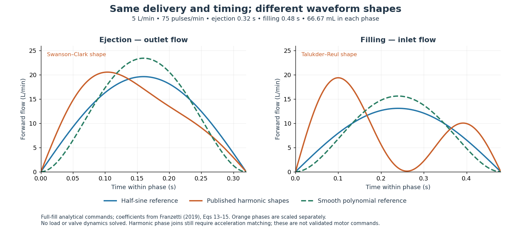

# Published waveform candidates and adjustable timing

Continuation: [volume-preserving waveform joining](DERIVATION_02_WAVEFORM_JOINING.md)
adds an adjustable endpoint window and a formula-driven spreadsheet. The raw
comparison below is preserved as the initial reference.

22 November 2026 · MECH0073 · waveform selection study, not a hydraulic simulation

**Closest starting point:** the Swanson–Clark ejection waveform and Talukder–Reul filling waveform reproduced in the supplied Franzetti article. Retain a half-sine option for a simple reference and the existing quintic motion as a smooth engineering comparison. No waveform is selected as a universal physiological target.

## Timing convention

The user requested a 60:40 fallback. This study explicitly interprets that as **filling:ejection**, consistent with the preceding 40% ejection illustration. It is a configurable assumption, not a universal physiological timing ratio. For one dedicated chamber, no dwell, 75 deliveries/min and 5 L/min:

$$
T=0.8\,\mathrm{s},\qquad t_\mathrm e=0.32\,\mathrm{s},\qquad t_\mathrm f=0.48\,\mathrm{s},\qquad V_\mathrm s=66.67\,\mathrm{mL}.
$$

The earlier ratio definition remains ejection divided by filling:

$$
r=\frac{t_\mathrm e}{t_\mathrm f}=\frac23,
\qquad t_\mathrm e=\frac{rT}{1+r},\qquad t_\mathrm f=\frac{T}{1+r}.
$$

Shape and ratio are separate input parameters. If dwell is later introduced, replace T with the available stroke time in the last two expressions. This timing is not the shared-chamber 1A schedule, which must accommodate separate right and left duties.

## What the accessible literature supplies

| Candidate | What is prescribed | Source and use | Transfer limit |
|---|---|---|---|
| Half-sine | Ejection flow | Franzetti 2019, Eq 13: simplified reference | Symmetric pulse; does not reproduce an early peak |
| Swanson–Clark harmonics | Ejection flow | Franzetti 2019, Eq 14: representative aortic shape attributed to Swanson & Clark 1977 | Historical template, not a patient measurement |
| Talukder–Reul harmonics | Filling flow / negative displacement flow | Franzetti 2019, Eq 15; optional alternative to its trapezoidal return | Must be volume matched and joined consistently; prescribed return does not reproduce all atrial mechanics |
| Early / middle / late ejection peak | Programmable flow shape | Hatoum, Moore & Dasi 2018: piston-loop comparison, DOI 10.1007/s10439-018-2102-y | Systolic duration also varied in the experiments; waveform effects cannot be treated as isolated at identical duration |
| Three cosine volume segments | Piston/chamber-volume command | Meskin et al. 2024: systole, early filling and late filling, DOI 10.1038/s41598-024-52327-6 | Volume commands must be differentiated to compare their flow shapes |
| Measured trace with Fourier or smooth interpolation | Target flow | Franzetti 2019 §2.3.2: fit a target trace and obtain piston motion | Requires the correct anatomical location, units, cycle integral and documented smoothing |

Primary implementation precedent: De Gaetano et al. (2015), *Fluid Dynamic Characterization of a Polymeric Heart Valve Prototype (Poli-Valve) tested under Continuous and Pulsatile Flow Conditions*, DOI [10.5301/ijao.5000452](https://doi.org/10.5301/ijao.5000452), describes use of Swanson–Clark ejection and a modified Talukder–Reul filling waveform in a pulse duplicator. This supports their experimental use, not validation of our geometry or gas-pocket model.

Meskin et al.'s three-segment controller independently adjusts segment duration and amplitude. Their reported test used 350 ms systole, 500 ms early diastole and 150 ms late diastole at 4.5 L/min. Those values are study conditions, not our defaults. [Primary methods](https://pmc.ncbi.nlm.nih.gov/articles/PMC10803730/), control software and fluid dynamic test protocol.

Hatoum et al. used piston acceleration/deceleration to alter peak timing at 5 L/min and 60 beats/min. This motivates a peak-time parameter for our comparison, but their limitations include differing ejection duration, an imperfect diastolic pressure trace and a rigid sinus chamber. Their experimental profiles have not been digitised here. [Primary methods and limitations](https://pmc.ncbi.nlm.nih.gov/articles/PMC6249097/).

Coronary or carotid waveforms are not automatically suitable aortic-valve targets. Tsai & Savaş (2010), DOI [10.1007/s11517-009-0573-6](https://doi.org/10.1007/s11517-009-0573-6), demonstrate site-specific waveform reproduction with a mean-flow pump plus a supplemental piston. For our intended ventricular source, distinguish the pump outlet from the downstream aneurysm location, where the intervening circuit changes the waveform. A pressure waveform likewise cannot be used directly as a flow or displacement command.

## Reproduce the published shapes while preserving the required volume

Define dimensionless phase time u between 0 and 1. Let a candidate shape be g(u), with positive integral G. Independently scale each phase:

$$
G=\int_0^1g(u)\,\mathrm du,
\qquad Q(t)=\frac{V_\mathrm s}{t_\mathrm{phase}}\frac{g(u)}{G}.
$$

Use consistent volume/time units. This construction guarantees delivery or filling volume V_s while allowing the duration to change. It means a fixed shape, duration and volume determine peak flow; peak flow is not a fourth independent quantity.

**Half-sine:** the normalised expression is

$$
g(u)=\sin(\pi u),\qquad G=\frac2\pi,
\qquad Q_\mathrm e(t)=\frac{\pi V_\mathrm s}{2t_\mathrm e}\sin\!\left(\frac{\pi t}{t_\mathrm e}\right).
$$

It applies only during ejection; the ideal outlet flow is zero during filling. The half-sine reference shown in the figure also uses a separately scaled half-sine filling phase.

**Swanson–Clark shape as reproduced by Franzetti Eq 14:**

$$
g_\mathrm e(u)=0.924\sin(\pi u)+0.230\sin(2\pi u)+0.092\sin(3\pi u),
\qquad G_\mathrm e=\frac2\pi\left(0.924+\frac{0.092}{3}\right).
$$

**Talukder–Reul shape as reproduced by Franzetti Eq 15:**

$$
g_\mathrm f(u)=0.520\sin(\pi u)+0.257\sin(2\pi u)+0.479\sin(3\pi u),
\qquad G_\mathrm f=\frac2\pi\left(0.520+\frac{0.479}{3}\right).
$$

The figure shows forward filling flow as positive. For signed piston displacement flow, filling is negative:

$$
Q_\mathrm p(t)=
\begin{cases}
\dfrac{V_\mathrm s}{t_\mathrm e}\dfrac{g_\mathrm e(t/t_\mathrm e)}{G_\mathrm e},&0\le t\le t_\mathrm e,\\[6pt]
-\dfrac{V_\mathrm s}{t_\mathrm f}\dfrac{g_\mathrm f((t-t_\mathrm e)/t_\mathrm f)}{G_\mathrm f},&t_\mathrm e<t\le T.
\end{cases}
$$

Negative piston displacement flow describes return/filling in this ideal separated-valve model; it does not command reverse flow through the aortic outlet. Actual gas, valve and load dynamics remain outside this calculation.

Franzetti multiplies the shapes by a peak-flow parameter and then adjusts the cycle for volume and derivative matching. Our comparison retains the published coefficients but uses **separate exact phase-volume normalisation**. It is not an implementation of their full optimisation routine. The original 1977 and 1978 works were bibliographically identified through Franzetti; their original equations were not independently inspected. The coefficients were visually verified in the user-supplied 2019 PDF, p. 5.

## Engineering smoothness reference

The existing quintic position profile is included as an engineering comparison, not as a literature-derived physiological waveform:

$$
h(u)=10u^3-15u^4+6u^5,
\qquad g(u)=h'(u)=30u^2(1-u)^2.
$$

Its unit-area flow shape and zero endpoint flow slopes allow continuous piston acceleration through the two phase joins for any positive durations. Its peak flow is higher than the half-sine at equal phase volume and duration, illustrating that smoother endpoints do not necessarily reduce peak flow or pressure loss.

For any chosen pair of shapes, inspect displacement, velocity, acceleration and the phase joins. Volume matching alone does not provide acceleration matching: the independently normalised half-sine and published harmonic pairs in this comparison have nonzero jumps in signed flow derivative at the joins. These would produce steps in the ideal inertial pressure term. Blend or constrain the joins while retaining volume and timing before interpreting the result as a hardware command. The figure is a shape comparison, not a validated motor trajectory.

## Calculated comparison

| Shape pair | Ejection peak (L/min) | Peak time / ejection duration | Filling peak (L/min) |
|---|---:|---:|---:|
| Half-sine / half-sine | 19.63 | 0.500 | 13.09 |
| Swanson–Clark / Talukder–Reul, separately normalised | 20.57 | 0.325 | 19.40 |
| Quintic / quintic | 23.44 | 0.500 | 15.63 |

These are calculated command values for 5 L/min, 75/min and the stated 60:40 filling:ejection allocation, not published experimental measurements. Every phase encloses 66.67 mL. The two filling peaks of the harmonic template are a shape feature; they do not establish patient-specific E/A physiology.

Reproduce with `python research/build_waveform_comparison.py` from the design directory, using NumPy and Matplotlib from the existing requirements. [Samples](waveforms/waveform_samples.csv) and [verification](waveforms/waveform_verification.json) record the inputs, source, integral checks, endpoint checks and acceleration-join differences. There is no new pressure calculation, maximum-force result, controller implementation or physical validation in this step. The starter spreadsheet is unchanged.

Next comparison: keep shape fixed while varying r; keep r fixed while varying shape. Use the same cycle volume, boundary load and fluid properties when evaluating pressure and force, and record any change needed to obtain feasible valve states. Both pump architectures remain under consideration.
